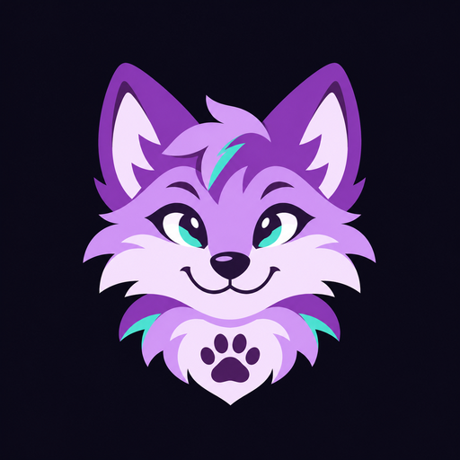

# FurHub

Your furry art library for Android and Windows, combining e621 and Inkbunny in one app.

Download the Android APK or Windows installer/portable executable from [GitHub Releases](https://github.com/shadowsight00/FurHub/releases).

## Latest update

- New FurHub name and fox-and-paw app icon.
- Both source pages publish as one settled batch. New pages append without shifting already displayed artwork.
- Windows preserves existing thumbnail/video elements during gallery updates, caches recently opened image bytes in bounded session memory, and reuses fresh account-scoped details.
- Android reuses fresh details, starts e621 images immediately, and decodes to the screen size until you zoom.
- Collapsible tags search the source of the viewed artwork. Image and video files keep their original resolution and downloads.

Network transfers finish at different times; tiles keep their places while media loads. No source preferences are bypassed.

Existing app identifiers and the Windows profile folder remain unchanged so updates retain accounts, collections and preferences.

## Build checkpoints

- Phase 1 passed cloud build, tests, lint and debug APK assembly: https://github.com/shadowsight00/FurHub/actions/runs/43953549116
- Phase 2 secure accounts/favorites passed cloud checks: https://github.com/shadowsight00/FurHub/actions/runs/43955152082
- Current 0.4.3 candidate includes the following/media/download/collections work below. The video viewer uses a TextureView, visible-page player ownership, decoder fallback, guarded setup and in-app retry. Automated tests cover player view inflation and surface detachment/release, alongside artwork and filtering behavior. Consult the latest successful source-import workflow for its cloud artifact; do not confuse earlier checkpoint APKs with this version.

## Implemented candidate features

- Two independent source search fields, live tag suggestions, paired search history and saved searches.
- One merged chronological grid with independent source pagination, refresh, cancellation, source errors and retry. Source-prefixed stable keys, lazy cached thumbnails with prefetching, adjustable persisted columns and chronological order.
- Native full-resolution image viewer with pan/pinch/double-tap zoom, cross-source swipe, GIF and Media3 video, metadata/tags/artists/pools, and ordered Inkbunny file navigation.
- Silent visible-only optimized video previews where a site provides preview variants; actual animated GIF thumbnails are supported. At most two previews run, pause on background and release offscreen. Autoplay defaults on; off/Wi-Fi-only/reduced-data controls persist. Full originals are never fetched to fill gallery thumbnails.
- Keystore AES-GCM credential vault, verified e621 API-key login, Inkbunny SID login, persistent connections, disconnect/account switching. Passwords are not retained. Registered Inkbunny settings are preserved; expired registered sessions require reconnect, never silent guest downgrade.
- Unified account favorites with optimistic e621 favorite editing and rollback. Inkbunny favorites are read-only because adding/removing them is not documented by its API; local bookmarks remain available.
- e621 account blacklist refresh and matching, plus source-side Inkbunny hidden flags. No app-added rating blacklist. Guest Inkbunny ratings use the official guest selection endpoint; private/guest-blocked content remains restricted.
- One Following gallery combining app-followed e621 artists with Inkbunny unread watched submissions. Viewed submissions are tracked locally; feed loading never clears the native unread list. e621 updates are scheduled about every four hours under Android network/battery constraints, with cached metadata. Inkbunny watchlist refresh and local favorite artists are available in Collections.
- Room stores mixed-source bookmarks/custom collections, paired saved searches, favorite artists, saved pool references, download history and cached following metadata.
- Original and selected-batch downloads run through WorkManager, with foreground notifications, progress, cancel/retry and collision-safe names. Choose an Android storage folder in Downloads; no broad storage permission is requested.
- e621 pool ZIP downloads use the complete ordered post-ID list. Each original is fully staged before entering the archive; a manifest records ordering, original filenames and missing/failed posts. Partial results are labeled **Completed with skips**. Cancellation removes partial output; storage-revocation cleanup failures are reported.
- All six primary sections: Explore, Favorites, Following, Collections, Downloads, Settings. Dark theme and adaptive app icon.

## Install using only your phone

Download the APK from [GitHub Releases](https://github.com/shadowsight00/FurHub/releases). For unreleased builds, open the latest successful source-import Actions run, download **FurHub-debug-apk**, extract the ZIP and open `app-debug.apk`. Allow installation from the app used to open the APK if Android requests it. No computer, terminal, Android Studio or source-file uploads are required.

## Validation and current limits

Compilation and synthetic tests do not prove live account/device behavior. Login, storage-provider access, background execution, media compatibility, large-image memory behavior and performance require physical-device testing. A public API connectivity report is included in cloud check reports when available; a cloud runner's connectivity does not prove a phone's connectivity.

Inkbunny's documented API does not expose favorite mutations, full blocking-preference export, or native unread-state clearing. These are explicitly not invented or claimed. Its session settings and hidden flags are respected; reconnect after changing account preferences.

These are debug builds. Release signing must be configured with owner-controlled GitHub Actions secrets before the manual signed-release workflow can run. No signing keys or account credentials belong in the repository. Android Keystore-backed account storage is app/device local and excluded from backup.

See [requirements](docs/REQUIREMENTS.md), [API notes](docs/API-NOTES.md), and [release signing](docs/RELEASE-SIGNING.md).
